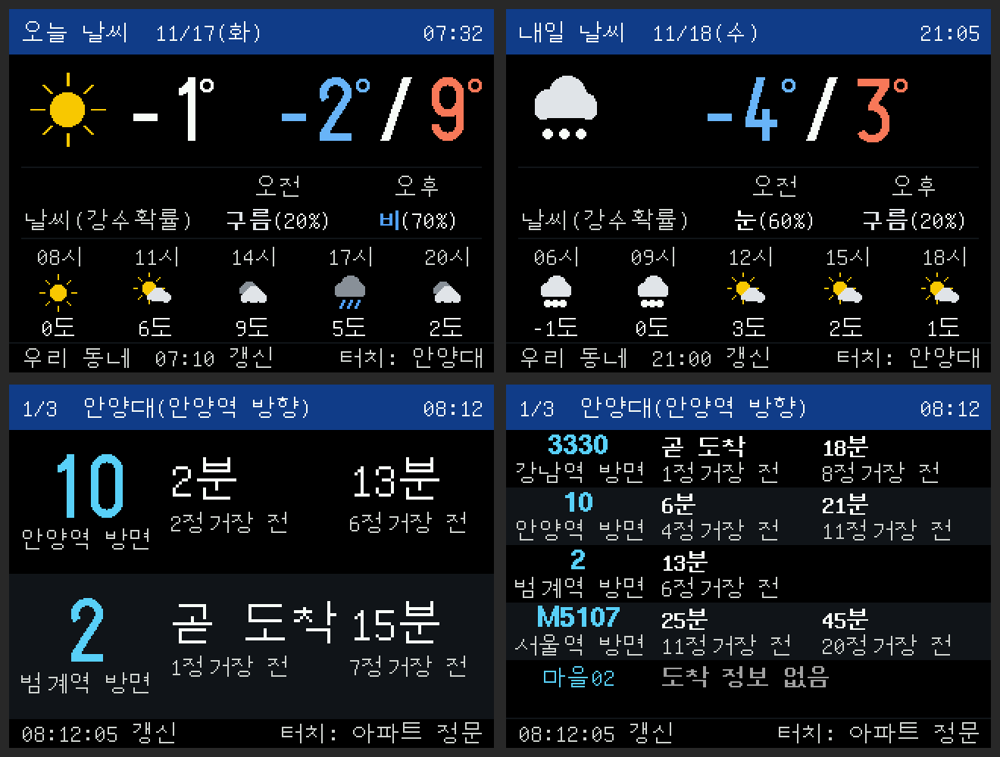

# 버스·날씨 알림판 (Raspberry Pi Pico W / ESP32)

공공데이터포털의 **버스 도착정보**와 **기상청 날씨**를 불러와 ILI9341 터치 화면(3.2인치/2.8인치)에 보여줍니다.

기본 구성은 **Raspberry Pi Pico WH + ILI9341 3.2인치 터치 모듈 + 브레드보드**입니다. **납땜이 필요 없습니다.** ESP32 개발보드나 CYD 보드에서도 같은 코드가 동작합니다.



*실제 화면 그리기 코드를 PC에서 돌려 만든 미리보기입니다. 왼쪽 위부터 오늘 날씨, 내일 날씨, 정류장 화면, 불러오는 중 화면.*

## 동작 방식

**평소 (기본 화면)**

| 시간 | 화면 |
|---|---|
| 06:00 ~ 12:00 | **오늘 날씨** (지금 기온, 최저/최고, 강수확률, 3시간 간격 예보) |
| 20:00 ~ 23:00 | **내일 날씨** (최저/최고, 오전/오후 날씨, 강수확률, 시간별 예보) |
| 그 밖의 시간 | 화면 꺼짐 |

**터치할 때마다**

```
기본 화면(날씨 또는 꺼짐) → 정류장 1 → 정류장 2 → 정류장 3 → 기본 화면 → ...
```

- 정류장 화면에서는 **15초마다** 도착 정보를 새로 받습니다. 그 사이에도 남은 시간은 화면에서 계속 줄어듭니다.
- 정류장 화면은 **30분** 동안 보여 준 뒤 기본 화면으로 돌아갑니다. 그 시간이 오전이나 저녁이면 날씨가, 그 밖의 시간이면 꺼진 화면이 됩니다.
- 화면이 꺼져 있을 때 터치하면 바로 정류장 1이 켜집니다.
- 터치 대신 Pico 위의 흰색 **BOOTSEL** 버튼을 눌러도 됩니다.
- 시간과 간격은 모두 `config.h`에서 바꿀 수 있습니다.

**그 밖의 기능**
- 경기도, 서울, 그 외 지역(TAGO) 버스 API 지원
- 첫 번째와 두 번째 버스의 남은 시간, 남은 정류장 수, 빈자리 수(경기도 광역버스) 표시
- 먼저 오는 버스부터 정렬, 정류장마다 원하는 노선만 골라 보기
- Wi‑Fi가 끊기거나 API가 실패하면 마지막 정보를 그대로 두고 아래에 경고만 표시

---

## 1. 준비물 (Pico WH 구성, 납땜 없음)

| 부품 | 하는 일 | 비고 |
|---|---|---|
| **Raspberry Pi Pico WH** | **두뇌 + Wi‑Fi** | 이름에 **W(Wi‑Fi)와 H(핀 납땜됨)**가 둘 다 있어야 함 |
| **ILI9341 3.2인치 TFT LCD 모듈(터치)** | 화면 + 터치 | SPI 방식, 핀 14개 |
| 브레드보드 830핀 | Pico WH를 꽂는 판 | |
| 점퍼선 M/F (수-암) | 브레드보드와 화면 연결 | 13가닥 사용 |
| USB‑A ↔ Micro 5핀 케이블 | 프로그램 업로드 + 전원 | **데이터 전송이 되는 케이블**이어야 업로드 가능 |
| 휴대폰 충전기 (5V 1A 이상) | 상시 전원 | |

Pico 2 WH도 핀 배치가 같아서 그대로 쓸 수 있습니다. (Arduino IDE에서 보드만 `Raspberry Pi Pico 2W`로 고르면 됩니다. 실제 보드로는 확인하지 않았습니다.)

### 1‑1. Pico WH를 브레드보드에 꽂기
1. 브레드보드 **가운데 홈을 가로지르도록** Pico WH를 꽂습니다. 양쪽 핀 줄이 홈의 양옆에 오게 합니다.
2. USB 단자가 브레드보드 끝을 향하게 두면 케이블을 꽂기 편합니다.
3. 핀이 모두 들어가도록 고르게 꾹 눌러 줍니다.

브레드보드는 **같은 번호 줄의 구멍 5개(a~e 또는 f~j)가 서로 연결**되어 있습니다. Pico 핀 하나가 한 줄을 차지하고, 같은 줄의 남은 구멍 4개에 점퍼선을 꽂으면 그 핀에 연결됩니다.

### 1‑2. 배선 (Pico WH 배선표)
**USB를 뺀 상태에서** 연결하세요. M/F 선의 **수(M)쪽은 브레드보드**, **암(F)쪽은 화면 핀**에 꽂습니다.

| 화면 모듈 핀 | Pico 핀 이름 | Pico 핀 위치 (번호) | 비고 |
|---|---|---|---|
| 1 VCC | **VBUS** (5V) | 40번 | |
| 2 GND | **GND** | 38번 | |
| 3 CS | **GP1** | 2번 | |
| 4 RESET | **GP20** | 26번 | |
| 5 D/C | **GP21** | 27번 | |
| 6 SDI (MOSI) | **GP3** | 5번 | 터치 T_DIN과 같은 줄 |
| 7 SCK | **GP2** | 4번 | 터치 T_CLK와 같은 줄 |
| 8 LED | **GP22** | 29번 | 백라이트 (화면 끄기용) |
| 9 SDO (MISO) | 연결 안 함 | | 터치 신호와 부딪히지 않게 비워 둠 |
| 10 T_CLK | **GP2** | 4번 | |
| 11 T_CS | **GP15** | 20번 | |
| 12 T_DIN | **GP3** | 5번 | |
| 13 T_DO | **GP0** | 1번 | |
| 14 T_IRQ | **GP28** | 34번 | |

화면 모듈 위쪽의 SD카드용 4핀(J4)은 연결하지 않습니다.

**핀 위치 찾는 법**: Pico를 USB 단자가 위로 오게 놓으면, 왼쪽 위가 1번(GP0)이고 왼쪽 줄을 따라 내려가며 1~20번, 오른쪽 아래에서 위로 올라가며 21~40번입니다. 오른쪽 맨 위가 40번(VBUS)입니다. Pico 뒷면에도 핀 이름이 인쇄되어 있습니다.

> ⚠️ **29번(GP22) 바로 옆 30번은 RUN**(리셋)입니다. LED 선을 30번에 꽂지 않도록 주의하세요.
> ⚠️ 39번(VSYS)이 아니라 **40번(VBUS)**에 VCC를 연결합니다.

GP2(4번)와 GP3(5번) 줄에는 선이 두 개씩 들어갑니다. 같은 줄의 빈 구멍에 나란히 꽂으면 됩니다.

**브레드보드 줄 번호로 보기**
Pico를 BOOTSEL 버튼이 보이는 면이 위로 오게, USB 단자가 1번 줄 바깥쪽(위)을 향하게 꽂으면 Pico의 1번 핀(GP0)이 **왼쪽 1번 줄**에 옵니다. 이 방향으로 봤을 때 왼쪽/오른쪽 기준으로 아래 줄에 꽂으면 됩니다.

| 화면 핀 | 꽂을 곳 |
|---|---|
| T_DO | **왼쪽** 1번 줄 (GP0) |
| CS | **왼쪽** 2번 줄 (GP1) |
| SCK, T_CLK | **왼쪽** 4번 줄 (GP2), 선 2개 |
| SDI, T_DIN | **왼쪽** 5번 줄 (GP3), 선 2개 |
| T_CS | **왼쪽** 20번 줄 (GP15) |
| VCC | **오른쪽** 1번 줄 (VBUS) |
| GND | **오른쪽** 3번 줄 (GND) |
| T_IRQ | **오른쪽** 7번 줄 (GP28) |
| LED | **오른쪽** 12번 줄 (GP22) |
| D/C | **오른쪽** 14번 줄 (GP21) |
| RESET | **오른쪽** 15번 줄 (GP20) |

Pico를 1번 줄이 아닌 곳부터 꽂았다면, Pico 1번 핀이 있는 줄을 1로 보고 세면 됩니다.

> 화면이 아예 안 켜지면 LED 선을 GP22 대신 **36번 3V3(OUT)**에 꽂고 `config.h`의 `TFT_BL`을 `-1`로 바꿔 보세요. 이 경우 백라이트를 끌 수 없어서, 꺼진 시간에는 화면을 검게만 칠해 둡니다.

### 1‑2‑1. 브레드보드 없이 F/F 선으로 연결할 때
터치선 3개를 **Pico의 다른 핀(SPI1)**에 따로 연결하면 모든 선이 **1:1**이 되어 F/F 선만으로 연결할 수 있습니다.

1. Pico를 브레드보드에서 빼서 **뒤집어 놓으면** 핀 옆에 이름(GP2, GND, VBUS…)이 인쇄되어 있습니다.
2. 아래처럼 화면 핀과 **Pico 이름**을 맞춰 연결합니다. (괄호 안은 핀 번호)

| 화면 핀 | Pico | | 화면 핀 | Pico |
|---|---|---|---|---|
| VCC | **VBUS** (40) | | SDO | 연결 안 함 |
| GND | **GND** (38 등 아무 GND) | | T_CLK | **GP10** (14) ← 바뀜 |
| CS | **GP1** (2) | | T_CS | **GP15** (20) |
| RESET | **GP20** (26) | | T_DIN | **GP11** (15) ← 바뀜 |
| DC | **GP21** (27) | | T_DO | **GP12** (16) ← 바뀜 |
| SDI | **GP3** (5) | | T_IRQ | **GP28** (34) |
| SCK | **GP2** (4) | | | |
| LED | **GP22** (29) | | | |

3. 코드 설정을 바꿉니다.
   - 버스 알림판 `config.h`: `#define TOUCH_SEPARATE_PINS 1`
   - 화면·터치 테스트 `HardwareTest.ino`: `#define TOUCH_SEPARATE_PINS 1`

> Pico 핀이 드러나 있으니 금속 물건 위에 두지 마세요.

### 1‑3. 전원
- **업로드할 때**: Pico WH의 **Micro USB**를 PC에 연결합니다.
- **평소 사용**: 같은 Micro USB 케이블을 **휴대폰 충전기**에 꽂아 둡니다.

<details>
<summary>ESP32 개발보드나 CYD 보드로 만들 때 (펼치기)</summary>

`config.h`의 `BOARD_CYD`로 고르고, Arduino IDE에서 보드를 `ESP32 Dev Module`로 선택합니다.

**ESP32 개발보드 + ILI9341 모듈 배선** (F/F 선으로 바로 연결)

| 화면 핀 | ESP32 핀 |
|---|---|
| VCC | 3V3 |
| GND | GND |
| CS | GPIO 5 |
| RESET | GPIO 4 |
| DC | GPIO 26 |
| SDI (MOSI) | GPIO 23 |
| SCK | GPIO 18 |
| LED | GPIO 22 |
| SDO (MISO) | GPIO 19 |
| T_CLK / T_CS / T_DIN / T_DO / T_IRQ | GPIO 25 / 33 / 32 / 39(VN) / 36(VP) |

**CYD (ESP32-2432S028R)** 는 배선이 필요 없고 `BOARD_CYD 1`로만 바꾸면 됩니다. 터치 대신 BOOT 버튼을 써도 됩니다.
</details>

---

## 2. API 인증키 받기 (공공데이터포털)

1. [data.go.kr](https://www.data.go.kr) 회원가입 후 로그인
2. 아래 API를 검색해서 **활용신청**합니다. 개발계정은 보통 바로 승인됩니다.

   | 용도 | 검색할 이름 | config.h |
   |---|---|---|
   | 버스 (경기도) | `경기도_버스도착정보 조회` | `BUS_PROVIDER 1` |
   | 버스 (서울) | `서울특별시_정류소정보조회 서비스` | `BUS_PROVIDER 2` |
   | 버스 (그 외 지역) | `국토교통부_(TAGO)_버스도착정보` | `BUS_PROVIDER 3` |
   | **날씨 (공통)** | `기상청_단기예보 ((구)_동네예보) 조회서비스` | |

3. **마이페이지 → 개발계정**에서 **일반 인증키**를 복사합니다. 버스와 날씨 모두 **같은 키 하나**를 씁니다. Encoding 키와 Decoding 키 중 어느 것을 넣어도 됩니다.

> 승인 직후에는 키가 서버에 반영되기까지 **1~2시간** 걸릴 수 있습니다. 그동안에는 화면에 "인증키 미등록"이 나옵니다.

---

## 3. 정류장 ID 찾기 (최대 3곳)

### 서울
정류장 표지판에 적힌 **5자리 숫자**(정류소 고유번호)가 정류장 ID입니다. 예: `"01234"`

### 경기도
경기도 API는 9자리 **정류소 ID**(예: `208000123`)를 씁니다. 표지판의 5자리 번호와는 다릅니다.

1. data.go.kr에서 `경기도_정류소 조회`도 활용신청합니다.
2. 브라우저 주소창에 아래 주소를 넣습니다. `인증키`와 `정류장이름`은 바꿔서 넣으세요.
   ```
   https://apis.data.go.kr/6410000/busstationservice/v2/getBusStationListv2?serviceKey=인증키&keyword=정류장이름&format=json
   ```
3. 결과에서 원하는 정류장의 `stationId` 값을 씁니다. 같은 이름의 정류장이 길 양쪽에 있으면 `mobileNo`(표지판 번호)로 구분하세요.

경기도 API는 정류장 이름을 알려주지 않으므로, `config.h`에 화면에 보일 이름을 직접 적어 주세요.

### 그 외 지역 (TAGO)
1. data.go.kr에서 `국토교통부_(TAGO)_버스정류소정보`도 활용신청합니다.
2. 도시 코드 목록:
   ```
   https://apis.data.go.kr/1613000/BusSttnInfoInqireService/getCtyCodeList?serviceKey=인증키&_type=json
   ```
3. 정류장 찾기 (cityCode는 위에서 찾은 값):
   ```
   https://apis.data.go.kr/1613000/BusSttnInfoInqireService/getSttnNoList?serviceKey=인증키&cityCode=25&nodeNm=정류장이름&_type=json
   ```
4. 결과의 `nodeid`를 정류장 ID에, 도시 코드를 `TAGO_CITY_CODE`에 넣습니다.

---

## 4. 날씨 위치 (위도·경도) 찾기
지도 앱(네이버 지도, 카카오맵, 구글 지도)에서 집 위치를 길게 누르면 위도와 경도가 나옵니다. 예: `37.5665, 126.9780`

이 값을 `config.h`의 `WEATHER_LAT`, `WEATHER_LON`에 넣으면 기상청 격자 좌표로 자동으로 바꿔서 씁니다. 소수점 둘째 자리 정도만 맞아도 충분합니다 (격자 한 칸이 5km).

---

## 5. 설정하기

`BusArrivalDisplay/config.example.h`를 같은 폴더에 **`config.h`** 라는 이름으로 복사한 뒤 값을 채웁니다.

```cpp
#define WIFI_SSID     "우리집와이파이"
#define WIFI_PASSWORD "비밀번호"
#define SERVICE_KEY   "발급받은_인증키"
#define BUS_PROVIDER  1                     // 1 경기, 2 서울, 3 TAGO

static const StationConfig STATIONS[] = {
    // 이름(화면 제목)       정류장 ID     보고 싶은 노선 (비우면 전부)
    {"집 앞 (서울 방향)", "208000123", ""},
    {"집 앞 (안양 방향)", "208000124", "11-3, 5"},
    {"회사 앞",          "208000456", ""},
};

#define WEATHER_LAT   37.5665               // 날씨 위치
#define WEATHER_LON   126.9780
#define WEATHER_LABEL "우리 동네"
```

시간표와 간격도 같은 파일에서 바꿀 수 있습니다.

| 설정 | 기본값 | 뜻 |
|---|---|---|
| `BUS_UPDATE_SEC` | 15 | 정류장 화면에서 몇 초마다 새로 받을지 |
| `STATION_SHOW_MIN` | 30 | 정류장 화면을 몇 분 동안 보여줄지 |
| `TODAY_WEATHER_START` / `END` | 6 / 12 | 오늘 날씨를 보여줄 시간 |
| `TOMORROW_WEATHER_START` / `END` | 20 / 23 | 내일 날씨를 보여줄 시간 |
| `WEATHER_UPDATE_MIN` | 30 | 날씨를 몇 분마다 새로 받을지 |

정류장은 1곳이나 2곳만 적어도 됩니다. 그러면 터치 순서가 그만큼 짧아집니다.

`config.h`에는 비밀번호와 인증키가 들어가므로 git에 올라가지 않게 해 두었습니다.

---

## 6. 업로드하기

> **처음에는 `HardwareTest/HardwareTest.ino`(화면·터치 테스트)부터 올리세요.** Wi‑Fi나 인증키 없이 배선만 확인합니다.
> 1. 색 화면: 바탕이 검정이고 칸의 색 이름과 실제 색이 같으면 정상입니다. 반대로 보이면 파일 위쪽 `INVERT_COLORS` 값을 반대로(`true` ↔ `false`) 바꿔 다시 올리고, 버스 알림판 `config.h`의 `TFT_INVERT_COLORS`도 같은 값으로 바꿉니다. (3.2인치 IPS 모듈은 `true`가 맞아서 기본값을 `true`로 해 두었습니다.)
> 2. 터치 화면: 화면을 누르면 "T_IRQ 신호: 눌림"으로 바뀌고 터치 횟수가 늘어나면 정상입니다.
> 3. BOOTSEL 버튼을 누를 때마다 백라이트가 꺼졌다 켜지면 LED 선도 정상입니다.
>
> 올리는 방법은 아래와 같고, 3개 모두 정상이면 같은 방법으로 `BusArrivalDisplay.ino`를 올립니다.

### 방법 A. Arduino IDE (처음이라면 추천)
1. [Arduino IDE](https://www.arduino.cc/en/software) 설치
2. **파일 → 기본 설정 → 추가 보드 관리자 URL**에 아래 주소를 넣습니다.
   ```
   https://github.com/earlephilhower/arduino-pico/releases/download/global/package_rp2040_index.json
   ```
3. **보드 매니저**에서 `Raspberry Pi Pico/RP2040/RP2350` (Earle F. Philhower, III) 설치
4. **라이브러리 매니저**에서 아래 3개를 설치합니다. 의존 라이브러리도 같이 설치하라고 하면 "모두 설치"를 누르세요.
   - `ArduinoJson` (Benoit Blanchon, 7.x)
   - `Adafruit ILI9341`
   - `U8g2_for_Adafruit_GFX`
5. `BusArrivalDisplay/BusArrivalDisplay.ino` 열기
6. **도구 → 보드**: `Raspberry Pi Pico W` (Pico WH도 이것을 고릅니다)
7. 왼쪽 위 **확인(✓)** 버튼으로 먼저 컴파일이 되는지 확인합니다. 보드가 없어도 됩니다.
8. **처음 한 번은 BOOTSEL 모드로 연결합니다.**
   1. USB를 뺀 상태에서 Pico 위의 흰색 **BOOTSEL** 버튼을 누른 채로
   2. Micro USB를 PC에 꽂고 버튼을 뗍니다.
   3. PC에 `RPI-RP2`라는 USB 드라이브가 보이면 성공입니다. (안 보이면 케이블이 충전 전용일 가능성이 큽니다.)
   4. **도구 → 포트**에서 `UF2 Board`를 고릅니다.
9. 업로드(→) 버튼을 누릅니다. 다음부터는 BOOTSEL 없이 일반 포트로 바로 업로드됩니다.

**ESP32로 만드는 경우**: 2번 주소 대신 `https://espressif.github.io/arduino-esp32/package_esp32_index.json`, 보드 매니저에서 `esp32` 설치, 보드는 `ESP32 Dev Module`, Partition Scheme은 `Huge APP`을 고릅니다.

### 방법 B. PlatformIO (VS Code)
이 폴더(`esp32-bus-display`)를 열고 실행합니다. 기본값은 Pico W이고, ESP32는 `-e esp32dev`를 붙입니다.
```bash
pio run -e pico_w -t upload
```
```bash
pio device monitor
```

---

## 7. 하루 호출 수 주의

개발계정 인증키는 API마다 **하루 호출 수가 제한**됩니다. 한도는 data.go.kr **마이페이지 → 개발계정 → 해당 API**의 "일일 트래픽"에서 확인하세요.

| 사용 | 호출 수 |
|---|---|
| 정류장 화면 1번 (30분 동안 15초 간격) | 버스 API **약 120회** |
| 날씨 (오전 6시간 + 저녁 3시간, 30분 간격) | 날씨 API 하루 약 30~40회 |

예를 들어 버스 API 한도가 하루 1,000회라면, 정류장 화면을 **하루 8번 정도** 30분씩 끝까지 띄울 수 있습니다. 확인하고 바로 끄고 싶으면 정류장 3 다음에 한 번 더 터치해 기본 화면으로 돌아가면 호출이 멈춥니다.

한도가 부족하면 `STATION_SHOW_MIN`을 줄이거나 `BUS_UPDATE_SEC`를 늘리고, 그래도 부족하면 data.go.kr에서 **운영계정**을 신청하세요.

---

## 8. 문제 해결

| 증상 | 해결 |
|---|---|
| 화면이 하얗거나 아무것도 안 나옴 | CS(GP1), D/C(GP21), RESET(GP20), SCK(GP2), SDI(GP3) 연결을 다시 확인. 선이 Pico 핀과 **같은 번호 줄**에 꽂혔는지 확인 |
| 화면이 아예 어두움 | LED 선을 36번 3V3(OUT)에 꽂고 `TFT_BL -1` |
| 터치해도 반응이 없음 | T_IRQ(GP28), T_CS(GP15) 연결 확인. 그래도 안 되면 `TOUCH_MODE 2`. 급하면 BOOTSEL 버튼으로도 넘길 수 있음 |
| 손대지 않았는데 화면이 저절로 넘어감 | `TOUCH_MODE 2`로 바꾸기. 그래도 그러면 T_DO(왼쪽 1번째) 연결 확인 |
| 터치가 가끔 안 먹음 | 정보를 받는 1~2초 동안은 터치를 못 읽음. 한 번 더 터치 |
| PC에 `RPI-RP2` 드라이브가 안 보임 | 데이터 전송이 되는 Micro USB 케이블로 바꾸기. BOOTSEL을 누른 채로 꽂았는지 확인 |
| (Pico) 아예 켜지지 않음 | LED 선이 30번(RUN)이나 37번(3V3_EN)에 잘못 꽂혔는지 확인 |
| 화면에 줄이 가거나 글자가 깨짐 | 점퍼선을 짧은 것으로 바꾸거나 `TFT_SPI_HZ`를 `20000000`으로 낮추기 |
| 색이 반전되어 보임 | `TFT_INVERT_COLORS` 값을 반대로 (`true` ↔ `false`). 3.2인치 IPS 모듈은 `true`가 맞음 |
| 화면이 뒤집혀 보임 | `TFT_ROTATION`을 1 ↔ 3으로 변경 |
| "Wi‑Fi 연결 실패" | 이름/비밀번호 확인. Pico W와 ESP32 모두 **2.4GHz만** 지원 (5GHz 안 됨) |
| "인증키 미등록" | 승인 후 1~2시간 기다리기. 그 API(버스 또는 날씨)를 활용신청했는지 확인 |
| "이 API 활용신청이 안 되어 있음" | 날씨면 `기상청_단기예보` 활용신청 확인 |
| "날씨 자료가 아직 없음" | 기상청 발표 직후일 수 있음. 2분 뒤 자동으로 다시 받음 |
| "오늘 호출 한도 초과" | 7번 참고 |
| 노선이 하나도 안 나옴 | 정류장 ID가 맞는지, 노선 필터의 번호가 정확한지 확인 |
| (CYD) 화면이 안 나옴 | USB 포트 2개짜리 CYD는 화면 칩이 ST7789라서 이 코드로는 안 될 수 있음 |
| 계속 재부팅됨 | 전원 부족. 다른 USB 어댑터나 짧은 케이블 사용 |

시리얼 모니터(115200)를 열면 터치, 화면 전환, 요청 결과, 오류 응답의 앞부분이 출력되어 원인을 찾기 쉽습니다.

---

## 9. 파일 구성

| 파일 | 하는 일 |
|---|---|
| `BusArrivalDisplay/BusArrivalDisplay.ino` | 전체 흐름 (터치, 화면 전환, 시간표, 갱신 주기) |
| `BusArrivalDisplay/app_logic.cpp` | 화면 전환 규칙 (몇 시에 무엇을, 터치 순서, 30분 제한) |
| `BusArrivalDisplay/bus_api.cpp` | 버스 API 주소 만들기, 응답 해석 (경기/서울/TAGO) |
| `BusArrivalDisplay/bus_fetch.cpp` | 버스 API 호출 |
| `BusArrivalDisplay/weather_api.cpp` | 기상청 API 주소, 격자 좌표 변환, 응답 해석 |
| `BusArrivalDisplay/weather_fetch.cpp` | 기상청 API 호출 (큰 응답을 조금씩 읽음) |
| `BusArrivalDisplay/arrival_text.cpp` | "6분 (4정거장 전)" 같은 화면 문구 만들기 |
| `BusArrivalDisplay/display.cpp` | 화면 그리기 (한글 글꼴, 날씨 아이콘, 바뀐 곳만 다시 그림) |
| `BusArrivalDisplay/touch.cpp` | 터치 감지 |
| `BusArrivalDisplay/net_util.cpp` | 인터넷 연결 공통 코드 |
| `BusArrivalDisplay/platform.cpp` | 보드마다 다른 부분 (Pico W / ESP32의 Wi‑Fi, 시계, 버튼) |
| `BusArrivalDisplay/config.example.h` | 설정 예시 |
| `HardwareTest/HardwareTest.ino` | 배선 확인용 화면·터치·백라이트 테스트 |
| `test_native/` | PC에서 응답 해석과 화면 전환 규칙을 확인하는 테스트 |

### PC에서 테스트 실행
API 응답 해석, 날씨 계산, 화면 전환 규칙은 보드 없이 PC에서 확인할 수 있습니다.
```bash
cd test_native && make
```
